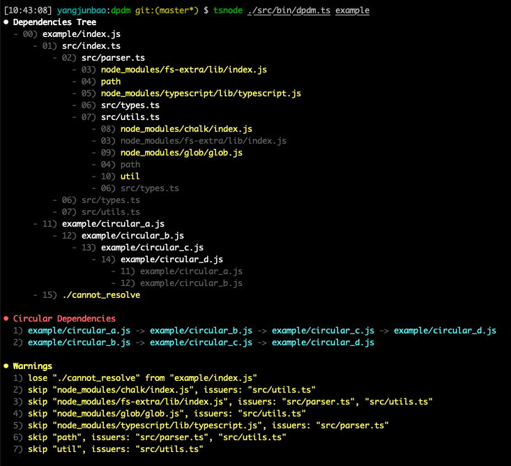

<h1 align="center">
    DPDM
    <br/>
    
    
    
    
    
</h1>

<p align="center">A robust static dependency analyzer for your <code>JavaScript</code> and <code>TypeScript</code> projects.</p>

<p align="center">
    <a href="#highlights">Highlights</a>
    <span>&nbsp;|&nbsp;</span>
    <a href="#install">Install</a>
    <span>&nbsp;|&nbsp;</span>
    <a href="#usage-in-command-line">Usage</a>
    <span>&nbsp;|&nbsp;</span>
    <a href="#options">Options</a>
    <span>&nbsp;|&nbsp;</span>
    <a href="#usage-as-a-package">API</a>
</p>

## Highlights

- Supports `CommonJS`, `ESM`.
- Supports `JavaScript` and `TypeScript` completely.
  - Supports TypeScript [path mapping](https://www.typescriptlang.org/docs/handbook/module-resolution.html#path-mapping).
  - Supports package-local `tsconfig.json` files and TypeScript project references.
  - Supports ignore TypeScript type dependencies.
- Supports `dpdm.config.ts` and JavaScript/JSON config files.
- Light weight: use [TypeScript](https://npmjs.com/package/typescript) to parse all modules.
- Fast: use asynchronous API to load modules.
- Stable output: This is compared to `madge`, whose results are completely inconclusive when analyze `TypeScript`.

## Install

1. For command line

   ```bash
   npm i -g dpdm
   # or via yarn
   yarn global add dpdm
   ```

2. As a module

   ```bash
   npm i -D dpdm
   # or via yarn
   yarn add -D dpdm
   ```

## Usage in command line

1. Simple usage

   ```bash
   dpdm ./src/index.ts
   ```

2. Print circular dependencies only

   ```bash
   dpdm --no-warning --no-tree ./src/index.ts
   ```

3. Exit with a non-zero code if a circular dependency is found.

   ```bash
   dpdm --exit-code circular:1 ./src/index.ts
   ```

4. Ignore type dependencies for TypeScript modules

   ```bash
   dpdm -T ./src/index.ts
   ```

5. Find unused files by `index.js` in `src` directory:

   ```bash
   dpdm --no-tree --no-warning --no-circular --detect-unused-files-from 'src/**/*.*' 'index.js'
   ```

6. Skip dynamic imports:

   ```bash
   # The value circular will only ignore the dynamic imports
   # when parse circular references.
   # You can set it as tree to ignore the dynamic imports
   # when parse source files.
   dpdm --skip-dynamic-imports circular index.js
   ```

7. Ignore specified imports when finding circular dependencies:

   ```bash
   dpdm ./src/index.js --skip-imports 'src/a.js:.*' src/c.js:src/d.js
   ```

8. Analyze files from another working directory:

   ```bash
   dpdm --cwd ../other-project ./src/index.ts
   ```

9. Show dependencies and circular dependencies grouped by package:

   ```bash
   dpdm --group-by-package './packages/*/src/index.ts'
   ```

10. Use a config file:

    ```typescript
    // dpdm.config.ts
    import { defineConfig } from 'dpdm';

    export default defineConfig({
      files: ['./src/index.ts'],
      exitCode: 'circular:1',
      transform: true,
      warning: false,
    });
    ```

    ```bash
    dpdm
    ```

    dpdm searches for `dpdm.config.ts`, `dpdm.config.mts`,
    `dpdm.config.cts`, `dpdm.config.mjs`, `dpdm.config.cjs`,
    `dpdm.config.js`, or `dpdm.config.json` in the working directory. CLI
    options override config file values.

11. Ignore imports from source comments:

    ```typescript
    // @dpdm-ignore
    import './intentional-cycle';
    ```

    The `@dpdm-ignore` comment can be placed before an `import`, `export`,
    `require()`, or dynamic `import()` dependency.

12. Ignore selected warnings:

    ```bash
    dpdm ./src/index.ts --ignore-miss-warning '^vscode$' --ignore-skip-warning '^node_modules/'
    ```

### Options

```bash
dpdm [files...]

Analyze the files' dependencies.

Positionals:
  files  The file paths or globs                                                            [string]

Options:
      --version                   Show version number                                      [boolean]
      --config                    the config file path, default searches dpdm.config.* in cwd
                                                                                            [string]
      --context                   the context directory to shorten path, default is cwd      [string]
      --cwd                       the working directory used to match files and resolve relative
                                  paths, default is current directory                       [string]
      --extensions, --ext         comma separated extensions to resolve
                                                  [string] [default: ".ts,.tsx,.mjs,.js,.jsx,.json"]
      --js                        comma separated extensions indicate the file is js like
                                                        [string] [default: ".ts,.tsx,.mjs,.js,.jsx"]
      --include                   included filenames regexp in string, default includes all files
                                                                            [string] [default: ".*"]
      --exclude                   excluded filenames regexp in string, set as empty string to
                                  include all files               [string] [default: "node_modules"]
  -o, --output                    output json to file                                       [string]
      --tree                      print tree to stdout                     [boolean] [default: true]
      --circular                  print circular to stdout                 [boolean] [default: true]
      --warning                   print warning to stdout                  [boolean] [default: true]
      --tsconfig                  the tsconfig path, which is used for resolve path alias, default
                                  is tsconfig.json if it exists in context directory. Project
                                  references are supported. When omitted, dpdm can use the nearest
                                  package tsconfig.json for each source file.               [string]
  -T, --transform                 transform typescript modules to javascript before analyze, it
                                  allows you to omit types dependency in typescript
                                                                          [boolean] [default: false]
      --exit-code                 exit with specified code, the value format is CASE:CODE,
                                  `circular` is the only supported CASE, CODE should be a integer
                                  between 0 and 128. For example: `dpdm --exit-code circular:1` the
                                  program will exit with code 1 if circular dependency found.
                                                                                            [string]
      --progress                  show progress bar                        [boolean] [default: true]
      --detect-unused-files-from  this file is a glob, used for finding unused files.       [string]
      --skip-dynamic-imports      Skip parse import(...) statement.
                                                              [string] [choices: "tree", "circular"]
      --skip-imports              Skip import edges from circular checks. Values are regexp
                                  ISSUER:DEPENDENCY pairs.                                   [array]
      --ignore-miss-warning       ignore miss warnings whose import request matches any specified
                                  regexp                                                     [array]
      --ignore-skip-warning       ignore skip warnings whose skipped file matches any specified
                                  regexp                                                     [array]
      --group-by-package          print dependencies and circulars grouped by nearest package.json
                                                                                           [boolean]
  -h, --help                      Show help                                                [boolean]
```

### Example output



## Usage as a package

```typescript jsx
import {
  defineConfig,
  parseDependencyTree,
  parseCircular,
  prettyCircular,
} from 'dpdm';

parseDependencyTree('./index', {
  /* options, see below */
}).then((tree) => {
  const circulars = parseCircular(tree);
  console.log(prettyCircular(circulars));
});
```

### API Reference

1. `parseDependencyTree(entries, option, output)`: parse dependencies for glob entries

   ```typescript jsx
   /**
    * @param entries - the glob entries to match
    * @param options - the options, see below
    */
   export declare function parseDependencyTree(
     entries: string | string[],
     options: ParserOptions,
   ): Promise<DependencyTree>;

   /**
    * the parse options
    */
   export interface ParseOptions {
     cwd: string;
     context: string;
     extensions: string[];
     js: string[];
     include: RegExp;
     exclude: RegExp;
     tsconfig: string | undefined;
     onProgress: (event: 'start' | 'end', target: string) => void;
     transform: boolean;
     skipDynamicImports: boolean;
   }

   export declare function defineConfig(config: Config): Config;

   export interface Config {
     files?: string | string[];
     cwd?: string;
     context?: string;
     extensions?: string | string[];
     js?: string | string[];
     include?: string | RegExp;
     exclude?: string | RegExp;
     output?: string;
     tree?: boolean;
     circular?: boolean;
     warning?: boolean;
     tsconfig?: string;
     transform?: boolean;
     exitCode?: string;
     progress?: boolean;
     detectUnusedFilesFrom?: string;
     skipDynamicImports?: 'tree' | 'circular';
     skipImports?: string | string[];
     groupByPackage?: boolean;
     ignoreMissWarning?: string | string[];
     ignoreSkipWarning?: string | string[];
   }

   export enum DependencyKind {
     CommonJS = 'CommonJS', // require
     StaticImport = 'StaticImport', // import ... from "foo"
     DynamicImport = 'DynamicImport', // import("foo")
     StaticExport = 'StaticExport', // export ... from "foo"
   }

   export interface Dependency {
     issuer: string;
     request: string;
     kind: DependencyKind;
     id: string | null; // the shortened, resolved filename, if cannot resolve, it will be null
   }

   // the parse tree result, key is file id, value is its dependencies
   // if file is ignored, it will be null
   export type DependencyTree = Record<string, Dependency[] | null>;
   ```

2. `groupDependencyTreeByPackage(tree, context)`: group dependencies by nearest package.json

   ```typescript jsx
   export declare function groupDependencyTreeByPackage(
     tree: DependencyTree,
     context: string,
   ): DependencyTree;
   ```

3. `parseCircular(tree)`: parse circulars in dependency tree

   ```typescript jsx
   export declare function parseCircular(tree: DependencyTree): string[][];
   ```

## TODOs

- [ ] Supports HTML and HTML like modules
- [ ] Supports CSS and CSS like modules
- [ ] Prints interactive SVG
